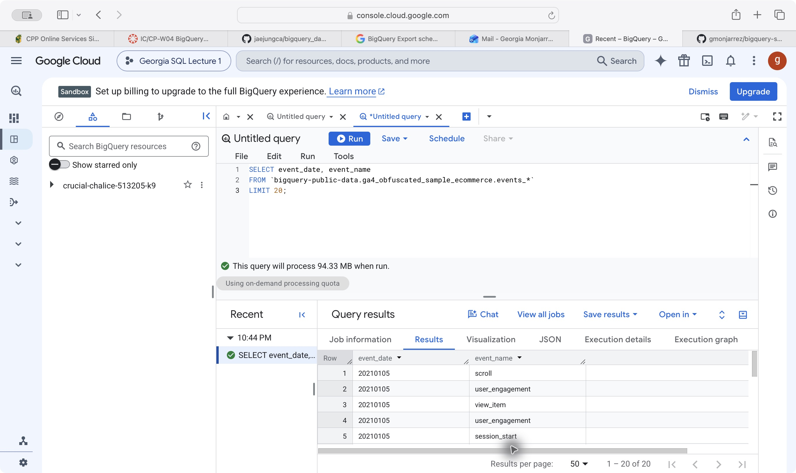
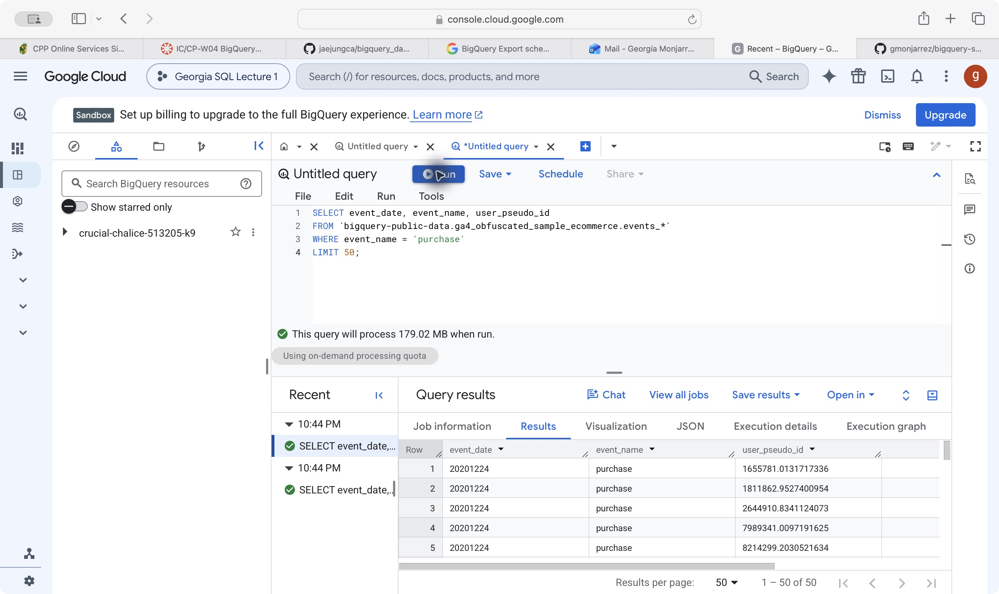
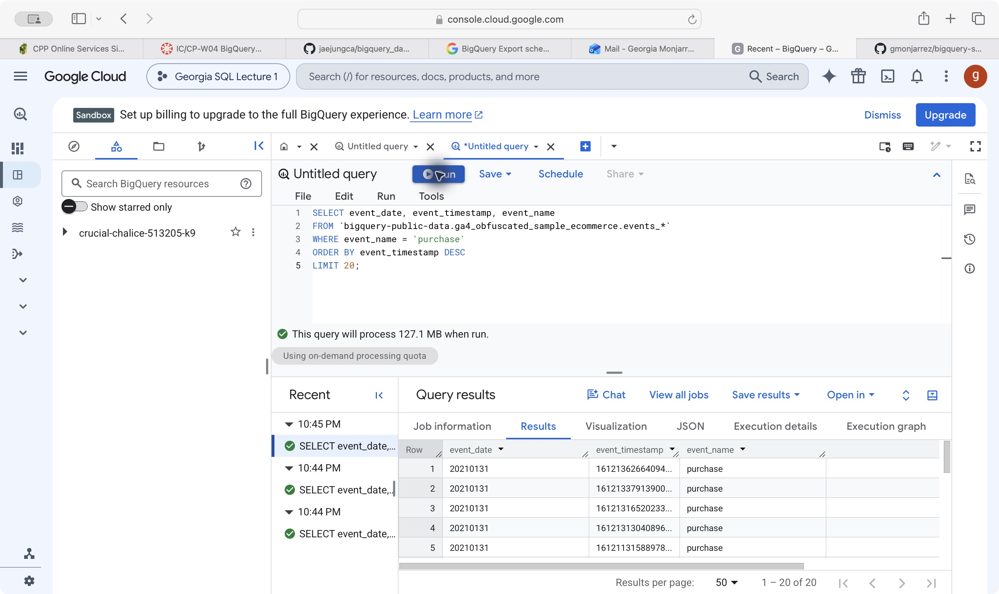
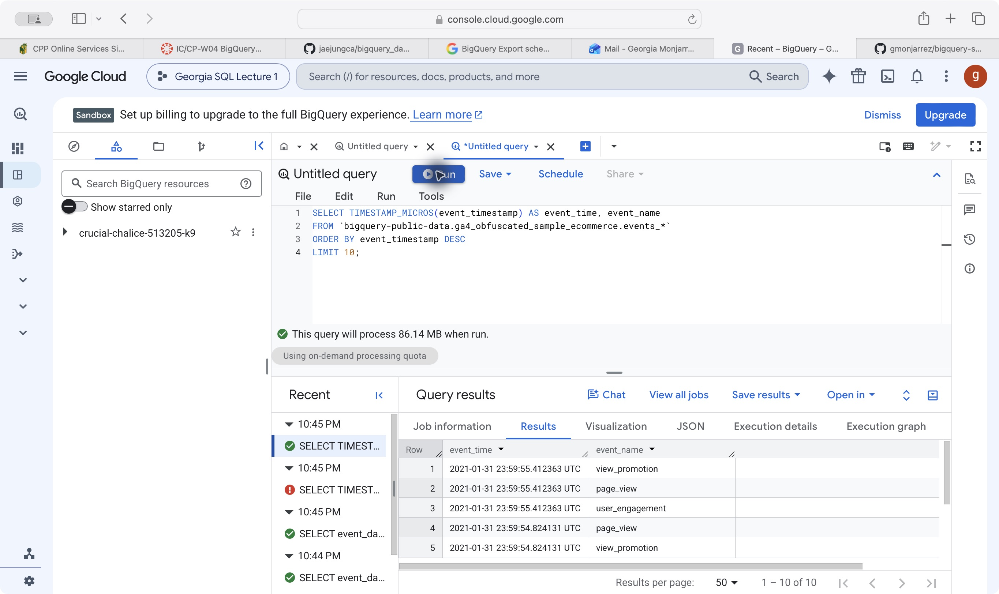
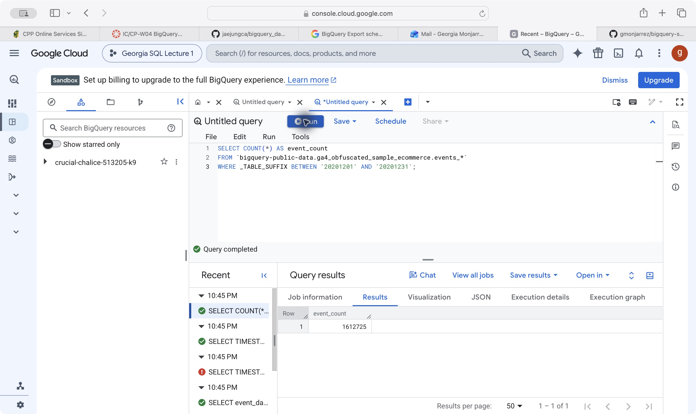
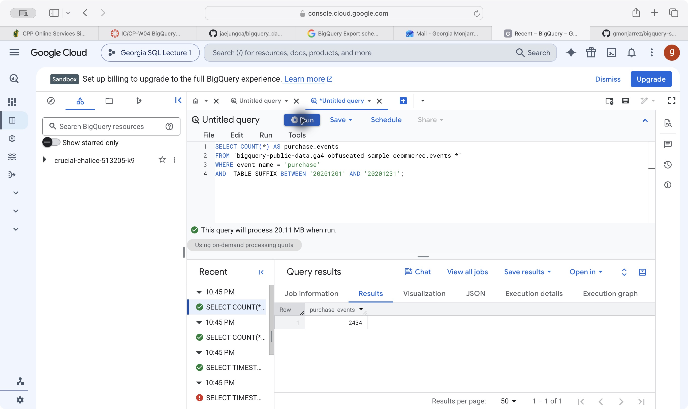
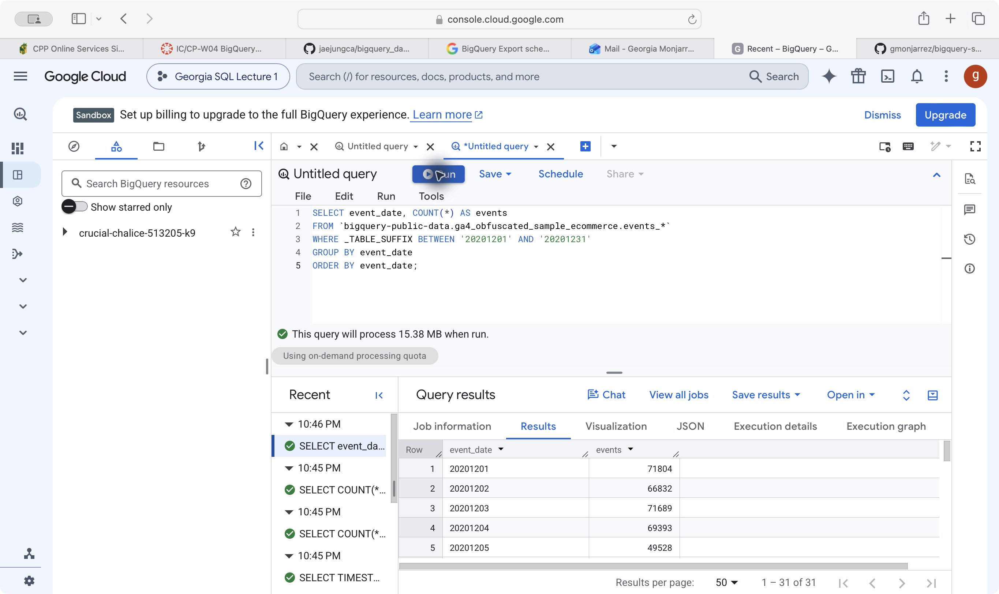
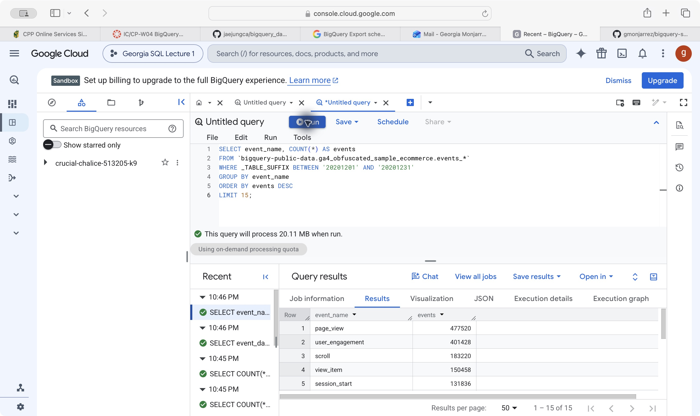
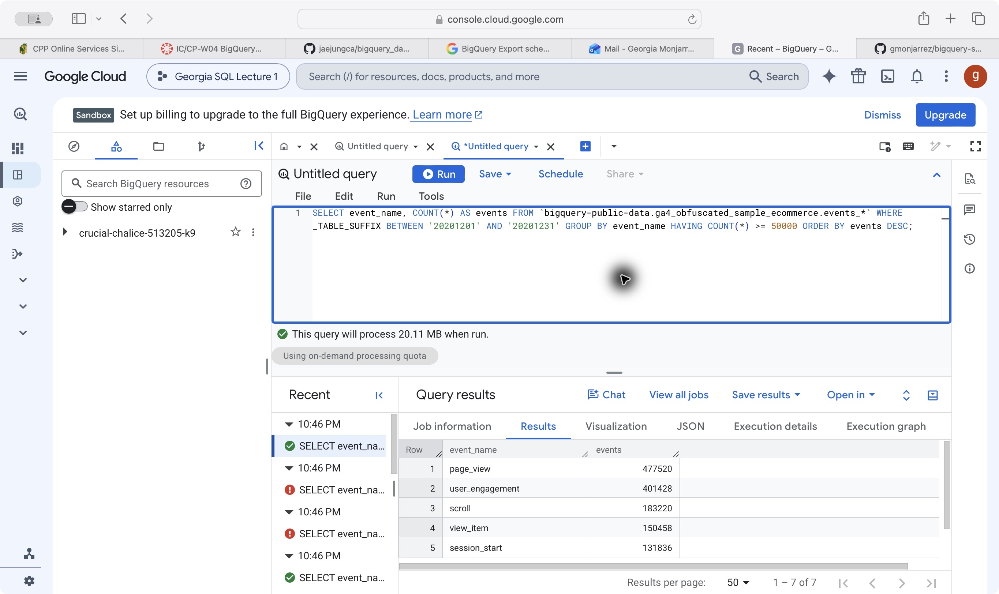
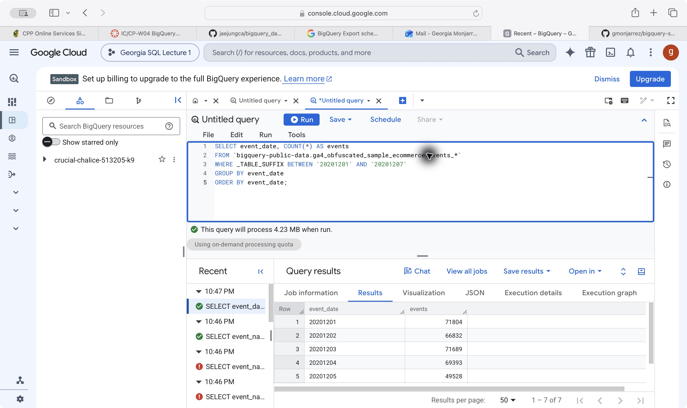

# Overview

These 10 queries explore the public GA4 ecommerce dataset using selection, filtering, sorting, and aggregation. All queries ran successfully in BigQuery. Screenshots show the visible portion of each result.

# Lecture queries

## Query 01: Selecting columns and limiting rows

```sql
SELECT event_date, event_name
FROM `bigquery-public-data.ga4_obfuscated_sample_ecommerce.events_*`
LIMIT 20;
```

Selects event dates and names and returns up to 20 rows. Without ORDER BY, the rows have no guaranteed order.

{fig-alt="Actual BigQuery SQL and results for Query 01"}

**Result:** The query returned 20 rows, including scroll, user_engagement, view_item, and session_start events.

## Query 02: Filtering purchase events

```sql
SELECT event_date, event_name, user_pseudo_id
FROM `bigquery-public-data.ga4_obfuscated_sample_ecommerce.events_*`
WHERE event_name = 'purchase'
LIMIT 50;
```

Returns up to 50 purchase events with their dates and user identifiers. Each row is an event, so a user may appear more than once.

{fig-alt="Actual BigQuery SQL and results for Query 02"}

**Result:** The query returned 50 purchase rows. The visible rows are dated December 24, 2020, with different user identifiers.

## Query 03: Sorting purchases by timestamp

```sql
SELECT event_date, event_timestamp, event_name
FROM `bigquery-public-data.ga4_obfuscated_sample_ecommerce.events_*`
WHERE event_name = 'purchase'
ORDER BY event_timestamp DESC
LIMIT 20;
```

Returns the 20 most recent purchases, sorted by timestamp from newest to oldest. GA4 timestamps are stored in microseconds.

{fig-alt="Actual BigQuery SQL and results for Query 03"}

**Result:** The query returned 20 purchases. The newest visible purchases occurred on January 31, 2021.

## Query 04: Converting timestamps for readability

```sql
SELECT TIMESTAMP_MICROS(event_timestamp) AS event_time,
       event_name
FROM `bigquery-public-data.ga4_obfuscated_sample_ecommerce.events_*`
ORDER BY event_timestamp DESC
LIMIT 10;
```

Converts timestamps into a readable UTC format and returns the 10 most recent events across all event types.

{fig-alt="Actual BigQuery SQL and results for Query 04"}

**Result:** The query returned 10 events. The latest visible timestamp is January 31, 2021, at 23:59:55.412363 UTC. Several events share that timestamp.

## Query 05: Counting all December events

```sql
SELECT COUNT(*) AS event_count
FROM `bigquery-public-data.ga4_obfuscated_sample_ecommerce.events_*`
WHERE _TABLE_SUFFIX BETWEEN '20201201' AND '20201231';
```

Counts all events from December 1–31, 2020. The table suffix filter selects the daily tables in that range.

{fig-alt="Actual BigQuery SQL and results for Query 05"}

**Result:** December had **1,612,725 events**.

## Query 06: Counting December purchases

```sql
SELECT COUNT(*) AS purchase_events
FROM `bigquery-public-data.ga4_obfuscated_sample_ecommerce.events_*`
WHERE event_name = 'purchase'
  AND _TABLE_SUFFIX BETWEEN '20201201' AND '20201231';
```

Counts purchase events during December 2020. This counts recorded events, not revenue or distinct buyers.

{fig-alt="Actual BigQuery SQL and results for Query 06"}

**Result:** December had **2,434 purchase events**.

## Query 07: Grouping events by day

```sql
SELECT event_date, COUNT(*) AS events
FROM `bigquery-public-data.ga4_obfuscated_sample_ecommerce.events_*`
WHERE _TABLE_SUFFIX BETWEEN '20201201' AND '20201231'
GROUP BY event_date
ORDER BY event_date;
```

Groups December events by date and counts each day’s events. The results are sorted chronologically.

{fig-alt="Actual BigQuery SQL and results for Query 07"}

**Result:** The result contains **31 days**. December 1 had 71,804 events, compared with 66,832 on December 2.

## Query 08: Ranking the top event types

```sql
SELECT event_name, COUNT(*) AS events
FROM `bigquery-public-data.ga4_obfuscated_sample_ecommerce.events_*`
WHERE _TABLE_SUFFIX BETWEEN '20201201' AND '20201231'
GROUP BY event_name
ORDER BY events DESC
LIMIT 15;
```

Counts December events by type, sorts them from most to least frequent, and returns the top 15.

{fig-alt="Actual BigQuery SQL and results for Query 08"}

**Result:** The result contains **15 event types**. Page views ranked first with 477,520 events, followed by user_engagement with 401,428.

## Query 09: Filtering groups with HAVING

```sql
SELECT event_name, COUNT(*) AS events
FROM `bigquery-public-data.ga4_obfuscated_sample_ecommerce.events_*`
WHERE _TABLE_SUFFIX BETWEEN '20201201' AND '20201231'
GROUP BY event_name
HAVING COUNT(*) >= 50000
ORDER BY events DESC;
```

Groups December events by type and keeps only types with at least 50,000 events. WHERE filters rows before grouping; HAVING filters the grouped results.

{fig-alt="Actual BigQuery SQL and results for Query 09"}

**Result:** **Seven event types** met the threshold. Purchase events were excluded because their count was below 50,000.

## Query 10: Querying a week with wildcard tables

```sql
SELECT event_date, COUNT(*) AS events
FROM `bigquery-public-data.ga4_obfuscated_sample_ecommerce.events_*`
WHERE _TABLE_SUFFIX BETWEEN '20201201' AND '20201207'
GROUP BY event_date
ORDER BY event_date;
```

Counts events for each day from December 1–7. The wildcard matches daily tables, while _TABLE_SUFFIX limits the date range.

{fig-alt="Actual BigQuery SQL and results for Query 10"}

**Result:** The result contains **seven days**, matching the same dates in the monthly query. The estimated data processed fell from 15.38 MB for the month to 4.23 MB for the week.


# Publication links

- [GitHub Pages report](https://gmonjarrez.github.io/bigquery-sql-lecture1/).
- [GitHub repository](https://github.com/gmonjarrez/bigquery-sql-lecture1).
